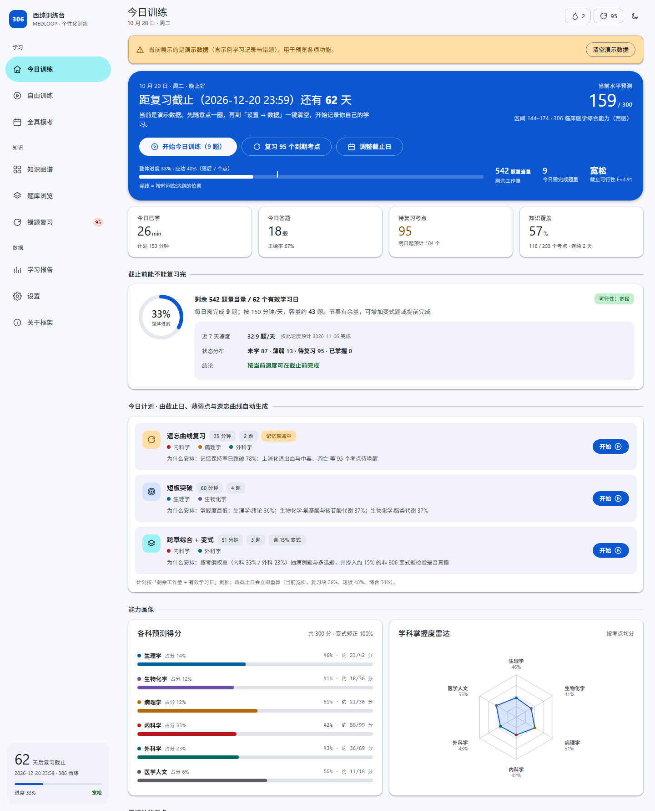
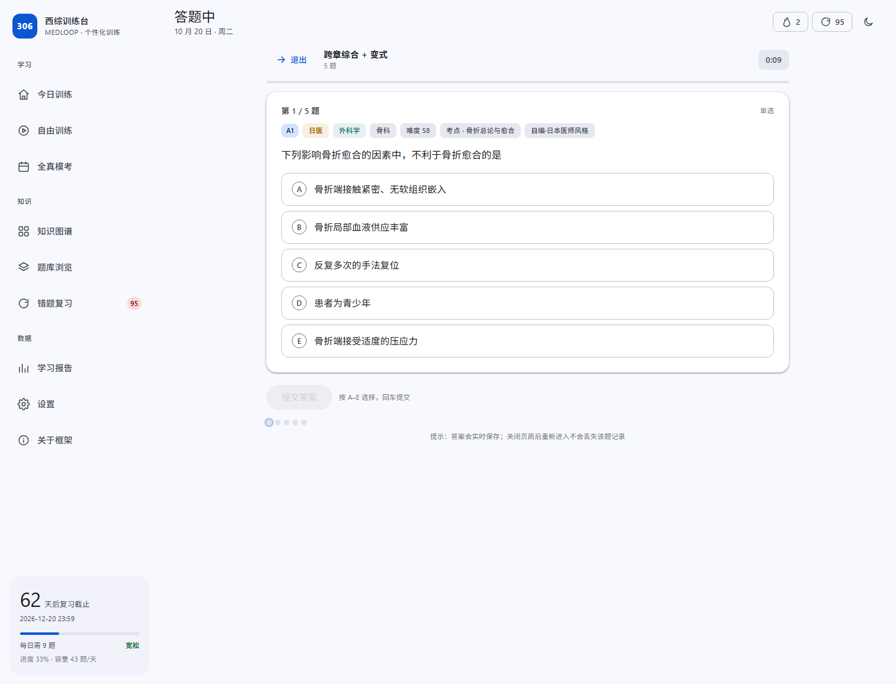

# 306 西综训练台 · MedLoop

一个**纯静态、零依赖**的 306 临床医学综合能力（西医）个性化训练工具。
按你设定的**复习截止日**倒推每天的题量，用**掌握度 + 记忆衰减**决定练什么，再用 **306 / 执业医师 / USMLE / 日本医师**四种题源反复验证同一考点是否真懂。

界面采用 **Material Design 3**（颜色角色 / 形状 / 高度 / 排版），支持浅色与深色主题。





---

## 1. 怎么打开

双击 `index.html` 即可（推荐 Chrome / Edge）。

- 不需要 Node、不需要构建、不需要联网
- 数据保存在浏览器 localStorage，不上传任何服务器
- 深色模式：点右上角月亮图标；或直接在地址后加 `?theme=dark`
- 首次打开会有一条引导，展示的是**演示数据**；到「设置 → 数据 → 清空演示数据」即可开始记录你自己的学习

> 如果双击后浏览器禁用了本地存储（少数企业策略），页面会提示"仅内存模式"——此时关闭页面数据会丢失，换 Chrome/Edge 打开即可。

**在线版（已部署）**：<https://tanshuidexiaolu.github.io/306-medloop/> —— 手机/电脑浏览器直接打开，无需安装；学习记录按设备各自保存。

**桌面入口**：桌面上已创建「306 西综训练台」快捷方式，双击即用 Chrome 应用模式打开（无地址栏/标签栏，带独立图标）。它指向本项目里的 `index.html`，**移动项目文件夹会让快捷方式失效**，需要重建。

### 手机上刷题

手机端已适配（底部导航 = 5 个主入口 + 「更多」、卡片单列、答题页全宽选项、知识图谱两行排布）。三种用法：

| 方式 | 做法 | 适用 |
|---|---|---|
| **局域网（推荐）** | 电脑运行 `node tools/serve.js`，手机与电脑连同一 Wi-Fi，浏览器打开命令输出的 `http://192.168.x.x:8080/` | 想随时刷、电脑开着即可；可「添加到主屏幕」 |
| 文件拷贝 | 把整个 `306-medloop` 文件夹拷到手机，用浏览器打开 `index.html`（Android 较方便，iOS 对本地文件限制多） | 完全离线、不依赖电脑 |
| 静态托管 | 把文件夹部署到 GitHub Pages / Cloudflare Pages 等静态站，手机访问域名 | 长期随时可用、换设备不折腾 |

> 学习记录按**设备**存在各自浏览器里，不会自动同步。迁移用「设置 → 数据与题库 → 导出 JSON」→ 另一台「导入备份」；两边都刷的话建议隔几天对一次，以最新进度为准（覆盖式导入）。

## 2. 现在能做什么

| 模块 | 功能 |
|---|---|
| **今日训练** | 倒计时到「复习截止」；进度 vs 应达进度；可行性评估（宽松/紧张/不可行 + 三条解法）；自动生成 3 个计划块并解释"为什么安排" |
| **自由训练** | 按**学科 / 章节 / 题型 / 题源 / 题量**自定义组卷；四类题源可混排（默认掺 15% 变式）；每次开始都重新随机抽题（仍优先薄弱/到期考点） |
| **全真模考** | 按 2026 考纲真实卷面结构（A1 40 / A2 75 / B 20 / X 30，共 165 题 300 分）组卷；答题卡、倒计时、交卷报告 |
| **知识图谱** | 6 学科 / 48 章 / 203 考点逐层下钻；掌握度、状态、记忆保持率、**风格迁移度**；每章可直接「练本章」 |
| **题库浏览** | 学科 / 题型 / 题源筛选 + 关键词搜索 + 解析详情 |
| **错题复习** | 遗忘曲线复习队列（按保持率排序）+ 错题本 + 错题重做 |
| **学习报告** | 预测分与区间、截止可行性、30 天趋势、学科雷达、题型/题源正确率、迁移度最低考点、未来 7 天复习负荷、学习热力图 |
| **设置** | 复习截止日（可自由调节）、每日时长、每周学习日、达标线、变式占比、六科自评、数据导入导出、题库导入 |
| **关于框架** | 架构、算法公式、四题源说明、数据契约、分期进度 |

### 核心模型（简单说）

- 每答一题，更新该考点的**掌握度** `m` 与**记忆稳定性** `S`
- 记忆保持率 `R = exp(-Δt/S)`；`R < 0.78` 进入复习队列 → 决定"今天复习什么"
- 计划：`剩余工作量 ÷ 有效学习日 = 每日目标`，再按复习 / 短板 / 综合切块
- 预测分：按学科分值权重 × 掌握度，并按覆盖率与变式表现修正
- **风格迁移度** = 非 306 正确率 ÷ 306 正确率；< 0.70 提示"可能只记住了题面"

## 3. 目录结构

```
306-medloop/
├─ index.html              页面外壳（含主题预置脚本，避免深色闪白）
├─ assets/styles.css       Material Design 3 设计系统（浅/深色）
├─ js/
│  ├─ data.js              考纲骨架：6 学科 / 48 章 / 203 考点 / 试卷结构 / 题源元信息
│  ├─ bank.js              题库装配与校验（字段、考点挂载、串题组、选N项）
│  ├─ engine.js            学习引擎：掌握度 / 记忆 / 截止日倒推 / 可行性 / 组卷 / 预测分
│  ├─ store.js              状态与 localStorage；演示数据；导入题库持久化
│  ├─ ui.js                外壳、路由、图表、题目渲染、答题状态机、涟漪
│  ├─ view-today.js        今日 + 自由训练
│  ├─ view-train.js        答题会话 + 模考 + 结果报告
│  ├─ view-knowledge.js    知识图谱 + 题库 + 错题复习
│  ├─ view-stats.js        学习报告 + 设置 + 关于 + 题库导入
│  └─ app.js               启动与首次引导
├─ data/
│  ├─ q-basic.js           早期样例题：生理 / 生化 / 病理（23 题）
│  ├─ q-clinical.js        早期样例题：内科 / 外科 / 人文（25 题）
│  ├─ q-ext.js             拓展样例题：USMLE / 日本医师 / 执业医师（9 题）
│  ├─ q-306-phys.js        生理学 50 题
│  ├─ q-306-bioc.js        生物化学 30 题
│  ├─ q-bioc-macro.js      生物大分子 39 题（自编扩展）
│  ├─ q-bioc-sugar.js      糖代谢 40 题（自编扩展）
│  ├─ q-bioc-oxi.js        生物氧化 40 题（自编扩展）
│  ├─ q-exam-phys-midterm.js   生理学期中模拟卷 60 题（问卷星导入，已整理配伍题）
│  ├─ q-exam-bioc-midterm.js   生物化学期中模拟卷 60 题（问卷星导入，已整理配伍题）
│  ├─ q-ext-usmle.js        USMLE 风格变式 30 题
│  ├─ q-ext-jp.js           日本医师风格变式 30 题
│  ├─ tr-usmle-en.js        USMLE 题英文原文（33 条）
│  ├─ tr-jp-ja.js           日医题日文原文（30 条）
│  ├─ tr-jp-extra.js        日文原文补充（ext-jp 3 条）
│  ├─ q-306-path.js        病理学 50 题
│  ├─ q-306-int-a.js       内科学·诊断学/呼吸/循环 38 题
│  ├─ q-306-int-b.js       内科学·消化/泌尿/血液/内分泌/风湿 40 题
│  ├─ q-306-sur.js         外科学 50 题
│  └─ q-306-hum.js         医学人文 18 题（自编，含法条与伦理）
├─ tools/
│  ├─ verify.js            全库一致性 + 算法自检 + 组卷能力
│  ├─ check_part.js        单文件题库校验（生产时用）
│  ├─ audit_report.js      覆盖率 / 查重 + 导出审核表 CSV
│  ├─ smoke.js             无浏览器渲染冒烟测试
│  ├─ serve.js             局域网静态服务器（手机刷题用）
│  └─ mobile_shot.js       手机视口截图（CDP，390px 真机宽度）
└─ docs/
   ├─ 框架方案-v0.2.md      产品方案（需求、架构、算法、题库生产计划）
   ├─ 题库审核表.csv        632 题逐题审核表（Excel 可直接打开）
   └─ shots/               界面截图
```

## 4. 题库格式与导入

在「设置 → 数据与题库 → 导入题目」粘贴 JSON 数组（或 `.json` 文件），会自动校验并挂载考点，**保存在浏览器本地**。

```json
{
  "id": "int-101",
  "subject": "internal",
  "chapter": "循环系统疾病",
  "kp": "冠心病与急性冠脉综合征",
  "style": "usmle",
  "type": "A2",
  "ask": "normal",
  "chooseN": 1,
  "caseId": "",
  "caseText": "男，58 岁，持续胸痛 2 小时……",
  "beyond": false,
  "difficulty": 0.7,
  "stem": "最恰当的下一步处理是",
  "options": ["…", "…", "…", "…", "…"],
  "answer": [1],
  "explain": "≥60 字，逐项说明错因",
  "tip": "记忆点",
  "source": "自编·人卫《内科学》第10版 P264"
}
```

- `chapter` / `kp` **必须**与 `js/data.js` 中的字符串逐字一致，否则该题会被丢弃（设置页会列出原因）
- `type`：`A1` / `A2` / `B` / `X` / `X2`（选 2 项）
- `style`：`cn306` / `cn_practice` / `usmle` / `jp`
- 串题：同一 `caseId` + `caseText`，`caseOrder` 排序；B 型题用 `bgroup` 共享选项
- `beyond: true` 表示 306 大纲外拓展知识，不计入掌握度与预测分

## 5. 题库与校验

```bash
node tools/verify.js                    # 全库一致性 + 算法自检 + 组卷能力
node tools/audit_report.js              # 覆盖率/查重，并导出 docs/题库审核表.csv
node tools/check_part.js data/q-xxx.js  # 生产新题库时的单文件校验
node tools/smoke.js                     # 无浏览器环境下渲染全部页面与答题状态机
```

当前题库：**632 题**，覆盖 **203 / 203 个考点（100%）**。

| 学科 | 题量 | 考点覆盖 | 考纲占分 |
|---|---|---|---|
| 内科学 | 115 | 43 / 43 | 33% |
| 生物化学 | 225 | 26 / 26 | 12% |
| 生理学 | 127 | 43 / 43 | 14% |
| 外科学 | 76 | 34 / 34 | 23% |
| 病理学 | 66 | 46 / 46 | 12% |
| 医学人文 | 23 | 11 / 11 | 6% |

题型：A1 231 · A2 232 · B 81（36 组共用选项）· X 81 · X2 7；另有病例串题组若干。
题源：306 统考 563 · 执业医师 3 · USMLE 33 · 日本医师 33（含你导入的两套问卷星期中模拟卷 120 题，已整理为 9 组配伍题并去重）。
**变式题带「原文」开关**：USMLE 题可一键切英文原文、日本医师题可切日文原文（`data/tr-*.js` 预存译文，离线可用）。
**全真模考（165 题 / 300 分）现在可以完整组卷开考。**

主体为**自编考纲仿真题**：按 2026 考纲的知识点结构命题，题型、难度和提问方式参照历年真题的公开命题特征校准，**不含任何真题原文**；另含你导入的两套问卷星期中模拟卷 120 题（保留原卷题干与答案，仅按 306 口径删减选项、整理配伍题）。

## 6. 已知限制

- 题库以自编仿真题为主，另含 120 题问卷星期中卷（你自己导入）；医学内容以人卫版教材口径为准，**正式刷之前建议用 `docs/题库审核表.csv` 过一遍**
- 单机工具：数据存在本机浏览器，不支持多设备同步；建议定期「导出 JSON」备份
- 难度分布偏中等（0.46–0.70 占多数），难题比例低于真实试卷，二轮时可按需补难

## 7. 演示用 URL 参数

| 参数 | 作用 |
|---|---|
| `?theme=dark` / `?theme=light` | 强制主题 |
| `?skiponboard` | 跳过首次引导（截图用） |
| `&quizdemo` | 直接开始一组 5 题的训练（演示答题页） |

